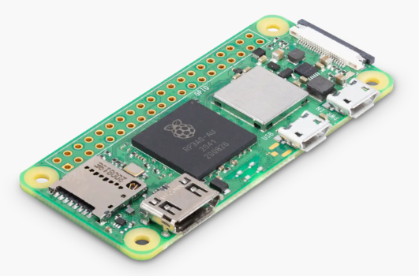
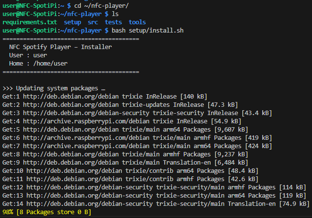

# Audio-Player-NFC

A standalone NFC-based Spotify player for the **Raspberry Pi Zero 2 W**.
Scan an NFC tag → music plays on your Bluetooth speaker. No screen, no app – just tap & play.

## Hardware
For Details see [Hardware Documentation](hardware-docs/README.md)

{width=48 height=16}

## How It Works

```
NFC Tag  →  PN532 (I2C)  →  Python app
                                 ↓
                          Spotify Web API
                          "Play this URI"
                                 ↓
                          Raspotify (librespot)
                          receives audio stream
                                 ↓
                          PulseAudio → Bluetooth A2DP → Speaker
```

## Hardware

| Component | Model |
|-----------|-------|
| Board | Raspberry Pi Zero 2 W |
| OS | Raspberry Pi OS Lite (Bookworm) |
| NFC Reader | PN532 NFC/RFID Module V3 |
| Speaker | Any Bluetooth A2DP speaker |

### Wiring (PN532 → Pi via I2C)

| PN532 Pin | Pi Pin | Description |
|-----------|--------|-------------|
| VCC | Pin 1 (3.3 V) | Power |
| GND | Pin 6 (GND) | Ground |
| SDA | Pin 3 (GPIO 2) | I2C Data |
| SCL | Pin 5 (GPIO 3) | I2C Clock |

> Set the PN532 DIP switches to **I2C mode**: SEL0 = ON, SEL1 = OFF.

## Pre-Requisites

- **Spotify Premium** account (required for playback control via API)
- A Spotify Developer App (see Step 2 below)

## Spotify Developer App einrichten (einmalig)

> Du brauchst **keine** Programmierkenntnisse – nur einen Spotify Premium Account.

1. Öffne [developer.spotify.com/dashboard](https://developer.spotify.com/dashboard)
2. Logge dich mit deinem normalen Spotify-Konto ein
3. Klicke **"Create App"**
   - Name: z.B. `NFC Player` (egal was)
   - Description: egal
   - Redirect URI: `http://localhost:8888/callback`
   - API: Web API ankreuzen
4. Nach dem Erstellen siehst du **Client ID** und **Client Secret** → diese beiden Werte kommen in `config.json`

Die Client ID / Secret sind **nicht** dein Spotify-Passwort – sie sind nur ein API-Schlüssel für deine App.

## Project Structure

```
Audio-Player-NFC/
├── config.json.example          # Template – copy to /boot/firmware/config.json
├── requirements.txt             # Python dependencies
├── src/
│   ├── main.py                  # Main loop: tag → Spotify
│   ├── config.py                # Reads /boot/firmware/config.json
│   ├── nfc_reader.py            # PN532 NFC reader (I2C)
│   ├── spotify_player.py        # Spotify Web API wrapper
│   └── bt_connect.py            # Bluetooth auto-reconnect service
├── setup/
│   ├── install.sh               # One-shot installer (run on Pi)
│   ├── nfc-player.service       # systemd service
│   └── bt-autoconnect.service   # systemd service
├── tools/
│   └── spotify_auth.py          # OAuth token generator (run on PC)
├── tests/
│   └── test_config.py           # Config module tests
├── LOCATION.md                  # SCP file mapping
└── README.md
```

## Setup Guide

### Step 1 – Prepare `config.json`

Copy `config.json.example`, fill in your values, and save as `config.json`:

```json
{
  "wifi": [
    { "ssid": "YourWiFi", "psk": "your-password", "priority": 10 }
  ],
  "bluetooth": {
    "speaker_mac": "AA:BB:CC:DD:EE:FF",
    "speaker_name": "My Speaker"
  },
  "spotify": {
    "client_id": "your_client_id",
    "client_secret": "your_client_secret",
    "redirect_uri": "http://localhost:8888/callback",
    "device_name": "NFC-Box"
  },
  "nfc_tags": {
    "04A1B2C3D4E5F6": "spotify:playlist:37i9dQZF1DXcBWIGoYBM5M"
  },
  "behavior": {
    "pause_on_remove": false
  }
}
```

### Step 2 – Generate Spotify Token (on your PC)

```bash
pip install spotipy
python tools/spotify_auth.py --config config.json
```

A browser opens for Spotify login. After granting access, a `spotify_cache` file is created.

### Step 3 – Copy Files to the Pi

Create your `.env` file from the example and fill in your Pi's IP and username:

```bash
cp .env.example .env
# Edit .env with your values
```

Then deploy with one command:

```bash
bash flash.sh              # deploy + reboot
bash flash.sh --no-reboot  # deploy only (dev)
```

See **[LOCATION.md](LOCATION.md)** for manual SCP commands and the detailed file mapping.

### Step 4 – Pair Bluetooth Speaker (on the Pi via SSH)

Use the built-in Bluetooth tool:

```bash
# Scan for nearby speakers (turn speaker on & into pairing mode first)
python3 ~/nfc-player/tools/bt_tools.py scan

# Connect and save to config.json (priority 1-10, 10 = highest)
python3 ~/nfc-player/tools/bt_tools.py connect AA:BB:CC:DD:EE:FF --priority 10

# Or connect by name
python3 ~/nfc-player/tools/bt_tools.py connect "JBL Flip 5" --priority 10

# List configured speakers
python3 ~/nfc-player/tools/bt_tools.py list

# Remove a speaker
python3 ~/nfc-player/tools/bt_tools.py remove AA:BB:CC:DD:EE:FF
```

The tool automatically saves the speaker to `config.json` with the given priority.
After a reboot, the Pi will auto-connect to the highest-priority available speaker.

### Step 5 – Install & Start (on the Pi via SSH)

```bash
cd ~/nfc-player
bash setup/install.sh
sudo reboot
```



After reboot the Pi will:
1. Connect to WiFi (from your configured list)
2. Auto-connect to the highest-priority Bluetooth speaker
3. Start Raspotify (Spotify Connect receiver)
4. Wait for NFC tags

### Step 6 – Write NFC Tags

Use any NFC writer app on your phone (e.g. *NFC Tools* for iOS/Android):

1. Open the app and tap "Write"
2. Add a **URI record** with a Spotify link, e.g.:
   `https://open.spotify.com/playlist/37i9dQZF1DXcBWIGoYBM5M`
3. Hold your NFC tag to your phone → write

That's it! The link is now on the tag. Hold the tag to the PN532 reader
and the music starts playing.

> **Tipp:** Du findest den Spotify-Link in der Spotify-App unter *Teilen → Link kopieren*.

## Managing the Device

```bash
# View live logs
journalctl -u nfc-player -f
journalctl -u bt-autoconnect -f

# Restart services
sudo systemctl restart nfc-player
sudo systemctl restart bt-autoconnect

# Edit config (then restart nfc-player)
sudo nano /boot/firmware/config.json
```

## Troubleshooting

| Problem | Fix |
|---------|-----|
| NFC reader not found | Check wiring, run `sudo i2cdetect -y 1` (should show `0x24`) |
| Spotify device not found | Check Raspotify: `sudo systemctl status raspotify` |
| No Bluetooth audio | Check connection: `bluetoothctl info AA:BB:CC:DD:EE:FF` |
| Token expired | Re-run `tools/spotify_auth.py` and copy new `spotify_cache` |

## Running Tests

```bash
python -m pytest tests/ -v
```
