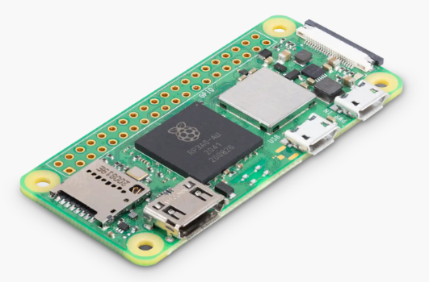
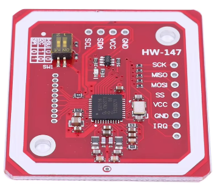

ToDo: Add a Hardware documentation here

## Hardware used in this project
1. [Raspberry Pi Zero 2W](https://www.raspberrypi.com/products/raspberry-pi-zero-2-w/)

2. [PN532 NFC Reader Module](https://www.nxp.com/docs/en/nxp/data-sheets/PN532_C1.pdf)

## Case Prints

Changelog

v0.0.1
fitting test for pi + NFC Reader Module

v0.0.2
fitting test no.2 with usb micro flot in the corner
